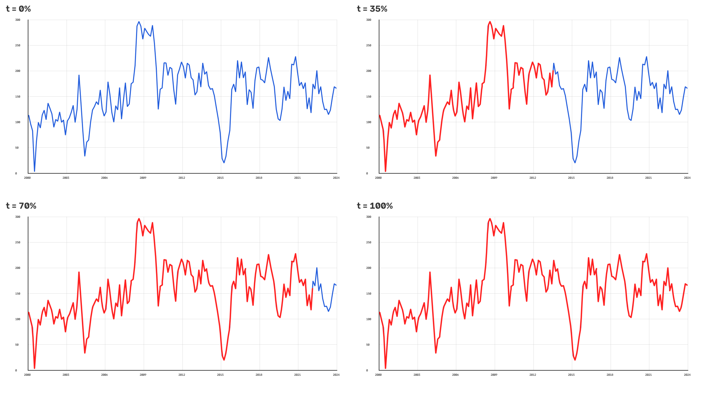

# MaxTrace+

Automatic graph-line tracing and write-on highlight animation for
**DaVinci Resolve Studio** (Fusion page, macOS / Apple Silicon).

Select the node that shows your chart, open **Workspace > Scripts > MaxTrace+**
and click **Generate Highlight**. MaxTrace+ captures the frame, finds the graph
line, traces its exact geometry (peaks, valleys and corners included), and
inserts an animated highlight that draws from the first point to the last.
You don't place any points or wire any nodes by hand.



## Install

Requirements: macOS and DaVinci Resolve **Studio**. Internet is needed once,
during installation; after that MaxTrace+ runs fully offline. No sudo.

**Easiest:** in Finder, double-click **`Install MaxTrace+.command`** in the
`MaxTracePlus` folder. If macOS says it is from an unidentified developer,
right-click it and choose **Open**. Or in Terminal:

```bash
cd MaxTracePlus
./install.sh                # install or update
./install.sh --check        # diagnose (or double-click "Check MaxTrace+.command")
```

Then **quit Resolve completely (Cmd+Q) and reopen it**; Resolve only reads
its Scripts folders at startup. MaxTrace+ appears in **Workspace > Scripts**.
On the Fusion page it may sit in a *Comp* submenu, on other pages in *Utility*.

What the installer does, in this order:

1. Copies the app to `~/Library/Application Support/MaxTrace+/app`.
2. Installs the menu script **before** anything that could fail, into both
   `~/Library/Application Support/Blackmagic Design/DaVinci Resolve/Fusion/Scripts/Comp/MaxTrace+.lua`
   and `.../Fusion/Scripts/Utility/MaxTrace+.lua` (and the same folders inside
   Mac App Store sandbox containers, if present).
3. Finds Python 3.9-3.13 (Homebrew, python.org, or the Xcode tools). If none
   is usable, it downloads a private, checksum-verified Python 3.12 into
   `~/Library/Application Support/MaxTrace+/python`.
4. Creates an isolated venv (`.../MaxTrace+/venv`) with NumPy and OpenCV and
   runs a self-test plus a detection smoke test.

Everything is logged to `~/Library/Application Support/MaxTrace+/logs/install.log`.
The installer never touches Resolve's internal Python, preferences or
security settings, other scripts, or your presets; an unrelated file named
`MaxTrace+.lua` stops it instead of being overwritten.

| Item | Location |
|---|---|
| Your presets / last settings / calibration | `~/Library/Application Support/MaxTrace+/presets`, `settings.json`, `calibration.json` |
| Rendered highlight sequences | `~/Library/Application Support/MaxTrace+/renders` |
| Cache and logs | `~/Library/Application Support/MaxTrace+/cache`, `logs` |

Uninstall:

```bash
./uninstall.sh           # keeps your presets, settings and rendered highlights
./uninstall.sh --purge   # removes everything
```

## Use

1. Put the graph image or clip on the timeline and open the **Fusion** page.
2. Select **Paint1** (or the MediaIn / any image node showing the graph).
3. **Workspace > Scripts > MaxTrace+** (the entry is listed on every page).
4. Click **Generate Highlight**. The status line shows the actual steps:
   reading the frame, detecting the line, generating the path, applying the
   animation, verifying.
5. Scrub the timeline. Change any setting and click Generate again; the
   previous MaxTrace+ result is replaced, never stacked.
6. **Remove Highlight** deletes only MaxTrace+ nodes and restores the
   original connections. A generation is a single Fusion undo step. The
   exception is the very first run on a new Resolve version: if MaxTrace+
   has to recalibrate, each correction pass is its own step.

### Panel

* **Source**: the node used. For a Paint node, the image *entering* it is
  analysed (so upstream Transform/Resize is included) and the highlight is
  composited over the Paint node's output. Existing strokes stay
  untouched underneath.
* **Trace**: *Auto Detect*, or *Pick Color* with a hex colour. **Line** lists
  every detected line (colour, type, confidence). **Preview** runs detection
  only and shows the source, the chosen path, other candidates, the start
  point (green) and any ambiguous spans (amber).
* **Style**: presets (Clean Red, Soft Red, Marker Yellow, Minimal Blue,
  Sharp White, or your own via *Save...*), colour swatches or hex, Thickness
  (pixels at the output; 7 px at 1080p scales to 14 px at 4K), Softness,
  Soft halo, Opacity, Subtle glow.
* **Animation**: Duration 0.5 to 10 s (frames come from the comp's frame
  rate), Motion (Linear = constant speed along the path's length, Smooth,
  Natural, Custom cubic-bezier), Start (comp start, current frame or a
  given frame), Trace range (entire line, or start/end percentages such as
  0-58%).
* **Advanced** (collapsed): detection sensitivity, gap bridging,
  simplification, a manual region (left, top, right, bottom as 0-1), output
  mode, verification, diagnostics, *Import Graph Image...*, Clean Cache, Logs.

### Output modes

* **Auto (default)**: creates a **native, editable Paint stroke**
  (`MaxTrace_Path`, a PolylineStroke whose Write On End is keyframed),
  renders it once to check alignment, width and timing against the traced
  path, and corrects the calibration automatically if needed. If it cannot
  be verified, it switches to the rendered sequence and says why in the
  panel.
* **Native editable stroke**: always native. Edit the points, brush,
  colour or keyframes in Fusion like any Paint stroke.
* **Rendered sequence**: MaxTrace+ draws the animation itself (supersampled,
  antialiased, straight-alpha PNG at the source resolution and comp frame
  range) and loads it with a `MaxTrace_Render` Loader. This output is not
  editable as a stroke; change settings and generate again instead.

Nodes created (native): `MaxTrace_Canvas` (transparent Background) ->
`MaxTrace_Stroke` (Paint with `MaxTrace_Path`) -> [`MaxTrace_Soft` /
`MaxTrace_SoftMix` halo] -> [`MaxTrace_Glow`] -> `MaxTrace_Merge` over your
node, whose previous downstream connections now come from the merge.

### Already-highlighted graphs

If the traced line already has the highlight colour, or part of it is
already drawn in another colour (a pre-highlighted section), MaxTrace+
traces the whole line, joining the parts, and warns you that a same-colour
reveal would barely be visible. Pick a contrasting colour (e.g. Marker
Yellow), add Soft halo or Glow, or use an unhighlighted source image.
Nothing is removed from your image.

## Troubleshooting

| Message | Meaning / fix |
|---|---|
| MaxTrace+ missing from Workspace > Scripts | Quit Resolve with Cmd+Q and reopen it; look for a *Comp* or *Utility* submenu. Then double-click **Check MaxTrace+.command**; it saves a report to your Desktop (`MaxTrace+ check.txt`). |
| *Open the Fusion page with your graph clip...* | The panel was opened without a Fusion composition; switch to the Fusion page and click **Use Selected**. |
| *Select the Paint, MediaIn or image node...* | No usable node is selected; select it and click **Use Selected**. |
| *Paint1 has no image connected to its input* | Connect the graph image to the Paint node. |
| *No continuous graph line was found* | Use **Pick Color**, raise **Sensitivity**, or set a **Region** in Advanced. |
| *Detection confidence is too low* | Check **Preview**, choose the right **Line**, or restrict the region. |
| *Could not read the frame from Fusion* | MaxTrace+ falls back to the original media file (and says so). Otherwise use **Import Graph Image...** |
| *The MaxTrace+ Python engine is not installed* | Run `./install.sh` again. |
| *Native stroke not used: ...* | Verification of the native stroke failed; the rendered sequence was used instead. The reason and measurements are in Diagnostics. |

Logs: `~/Library/Application Support/MaxTrace+/logs/` (`maxtrace.log`,
`worker.log`).

## How it works

* `resolve/MaxTrace+.lua`: launcher in Resolve's Scripts menu.
* `lua/maxtrace/`: Fusion integration (`fusionio.lua`), UIManager panel
  (`ui.lua`), controller (`main.lua`), background jobs (`worker.lua`),
  settings and presets (`config.lua`).
* `engine/maxtrace/`: Python engine that runs as a separate process:
  detection (`detect.py`), geometry (`geometry.py`), timing (`easing.py`),
  rendering (`render.py`), Fusion node text (`fusion_setting.py`), render
  verification (`verify.py`) and the job runner (`worker.py`). Lua and Python
  communicate through job files on disk; there is no network server, and
  heavy work never runs on Resolve's UI thread.

Detection projects every pixel onto the background-to-line-colour axis in
Lab space, which handles antialiasing, JPEG and other series. It then
removes long straight axes and gridlines, follows the line column by column
with dynamic programming (bridging labels only when the gap is plausible),
and falls back to skeleton tracing for curves that double back. Finally it
simplifies with Ramer-Douglas-Peucker and fits the corners, spike tips and
end caps back to the ink so sharp peaks stay sharp. Details and the
evidence behind every Fusion call are in
[docs/FUSION_API_NOTES.md](docs/FUSION_API_NOTES.md). Test results are in
[docs/TEST_REPORT.md](docs/TEST_REPORT.md).

## Limitations

* MaxTrace+ was built and tested without access to DaVinci Resolve. Its
  Fusion integration follows serialisations from real Resolve/Fusion
  compositions and is verified against Resolve on each native generation.
  If that check fails, the rendered output is used automatically. The
  first real run on your Mac is the first live test.
* Lines hidden under labels or other series are bridged straight; geometry
  that isn't visible can't be recovered.
* Two series of the *same* colour that cross can be ambiguous: choose the
  line in **Line** or restrict the **Region**.
* The width of Soft halo and Glow is approximate in native mode (Fusion's
  Blur and SoftGlow units) and exact in rendered mode.
* MaxTrace+ needs DaVinci Resolve **Studio**: the free version of Resolve
  19.1+ no longer provides UIManager windows to scripts.

## Tests

```bash
python3 -m pip install numpy opencv-python-headless pytest lupa
python3 -m pytest tests -q
```
